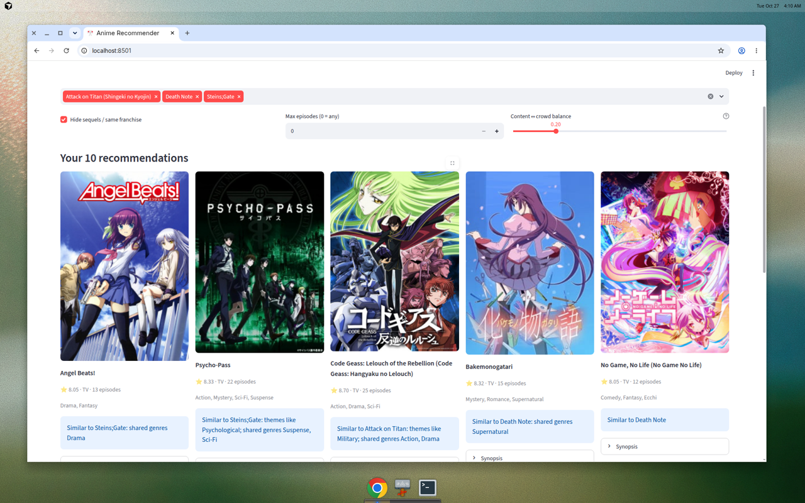
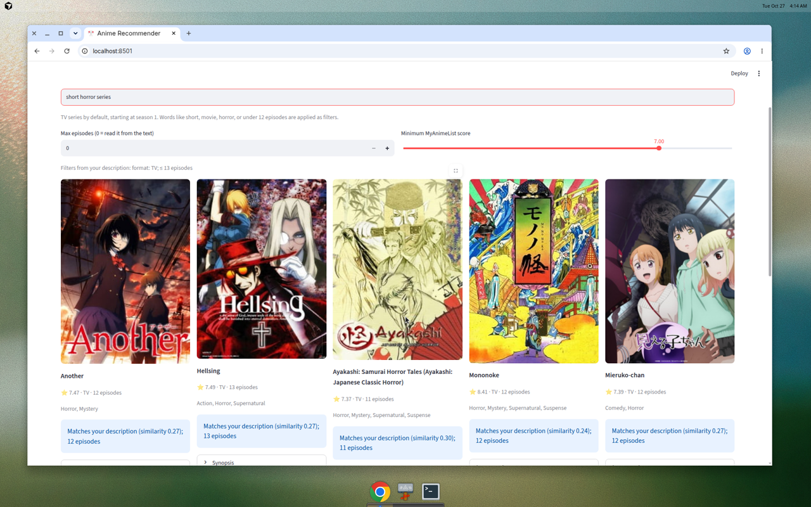

# Anime Recommender

Pick 3–5 anime you love and get 10 suggestions, each with a poster, a MyAnimeList score, and a one-line reason grounded in shared genres and themes. A second box takes a plain-English vibe (“short horror series”, “dark psychological thriller”) and returns TV series that match, starting at season 1. The model blends sentence embeddings of each show’s description with collaborative filtering on about a million MyAnimeList ratings. On a held-out test, that blend scores about 30% higher than “just recommend the most popular shows” (NDCG@10 0.614 vs 0.471).

**Live demo:** [https://frisky-anime-recommender.streamlit.app/](https://frisky-anime-recommender.streamlit.app/)

[](https://frisky-anime-recommender.streamlit.app/)





## Results

Protocol: for each user, hide a random 20% of ratings. The model sees the other 80% and must return 10 shows the user has not already rated. A hit is a hidden show rated **8 or higher**. Settings were tuned on half the users. The table is the other **407** users (`results/metrics.json`).

**Recall@10** is hits divided by *every* held-out favorite, which is often hundreds of titles, so only 10 slots make recall look small. **Precision@10** of 0.60 means about 6 of the 10 suggestions were real favorites. These users each rated around a thousand shows, so the absolute numbers are a comparison between models, not a promise about a new visitor.

| Model | Precision@10 | Recall@10 | NDCG@10 |
|---|---:|---:|---:|
| Most popular (baseline) | 0.443 | 0.043 | 0.471 |
| Content: TF-IDF | 0.252 | 0.028 | 0.268 |
| Content: sentence embeddings | 0.084 | 0.009 | 0.090 |
| Collaborative filtering: ALS (32 factors) | 0.572 | 0.059 | 0.583 |
| **Hybrid (0.2 content + 0.8 ALS)** | **0.600** | **0.063** | **0.614** |

The hybrid is the best of the five. Content-only loses to popularity on this test: heavy watchers’ hidden favorites skew toward famous shows, and “similar plot” alone misses that. Content still earns its place in the blend, and it is what makes vibe search and recommendations for rarely rated titles work.

The app is used differently: someone names 3–5 favorites, not 80% of a thousand ratings. A second test does that (each user’s top 3, 4, or 5 training titles rated ≥ 8). The best blend there is **0.1 content / 0.9 ALS** (NDCG@10 0.521), a small step above ALS alone (0.516) and above popularity (0.471). The slider still starts at **0.2**, the winner of the full-history test above. Moving it to 0.1 is one click.

| Model (3–5 favorites) | Precision@10 | Recall@10 | NDCG@10 |
|---|---:|---:|---:|
| Most popular | 0.443 | 0.043 | 0.471 |
| Content: sentence embeddings | 0.090 | 0.010 | 0.103 |
| ALS | 0.486 | 0.051 | 0.516 |
| **Hybrid (0.1 content + 0.9 ALS)** | **0.488** | **0.051** | **0.521** |
| Hybrid at the app default (0.2) | 0.480 | 0.050 | 0.511 |

## How it works

1. **Content.** Each anime’s title, official genres, themes, audience, and synopsis is turned into a 384-number meaning vector with `all-MiniLM-L6-v2`. Those vectors are computed once and saved. Similar stories land near each other. A TF-IDF (keyword) model is kept for the comparison table.
2. **Crowd.** Implicit ALS learns 32 taste factors from the ratings. Shows that the same people score highly end up near each other.
3. **Blend.** Both scores are z-scored and mixed. The default is 20% content and 80% crowd. A title with fewer than 50 ratings trusts the crowd less, so a new show can still be recommended from its description. A small bonus goes to a higher MyAnimeList score.
4. **One card per franchise.** Seasons, movies, and obvious sequels collapse to a single entry. The card you see is the place to start (usually the first TV season). Franchises you already picked are left out.
5. **Why line.** The line names the favorite with the most shared official themes and genres. “People who liked X also liked this” is added only when the two shows share fans well beyond what their popularity would predict (at least 50 shared high ratings, and lift of at least 1.45).

Vibe search embeds the description with a small ONNX copy of the same MiniLM model, loaded the first time someone searches. With no format word, results are TV series. “Short” means 13 episodes or fewer. “Movie”, “OVA”, and “under 25 episodes” are read as filters. Episode counts are pluralized (“1 episode”, “12 episodes”).

## What I’d do next

- Ratings from more than 813 very active users, so recent shows such as Frieren can use the crowd signal. Today they lean on the description.
- A time-based split, so the test predicts future watches.
- A curated franchise list for side stories whose titles do not look like “Season 2”.
- A diversity pass so the top 10 is not five school dramas.
- Optional rewritten why-lines, still tied to the same genre and theme overlap.

## Data

Public files, no login. The app catalog is **7,423 anime** (1958–2025) and **1,015,487 ratings** from **813 users**.

| Source | What it provides | License |
|---|---|---|
| [Quan Than, “Top 15,000 Ranked Anime Dataset”](https://www.kaggle.com/datasets/quanthan/top-15000-ranked-anime-dataset-update-to-32025) (March 2025), used through the Hugging Face mirror [`TheRealVigilante/Processed_Top_15k_Anime`](https://huggingface.co/datasets/TheRealVigilante/Processed_Top_15k_Anime) | Synopsis, poster, score, members, type, episodes, titles | Apache License 2.0 |
| [`lyfesan/myanimelist-top-anime-dataset`](https://huggingface.co/datasets/lyfesan/myanimelist-top-anime-dataset) (September 2025) | Official MyAnimeList genres, themes, and demographic | MIT |
| [`krishnaveni76/UserRatings`](https://huggingface.co/datasets/krishnaveni76/UserRatings) | User ratings (5–10) | Apache License 2.0 |
| [`krishnaveni76/Animes`](https://huggingface.co/datasets/krishnaveni76/Animes) | Gap-fill only: rated titles missing from the 2025 dump | Apache License 2.0 |

Cleaning keeps TV, movies, OVAs, ONAs, and specials with at least 5,000 members and a real synopsis, and drops adult and music-video rows. Demon Slayer, Jujutsu Kaisen, Spy x Family, Frieren, and Kaguya-sama are in the picker. Posters are hotlinked from the MyAnimeList CDN already stored in the source file.

## Run it

```bash
python -m venv .venv && source .venv/bin/activate
pip install -r requirements.txt
streamlit run app.py
pytest -q
```

Python 3.12 (`runtime.txt`, and the dev container). The first page load reads the saved vectors and does not download a model. The first vibe search downloads the ONNX MiniLM weights (about 90 MB, cached by fastembed).

Rebuild the catalog and the models (CPU, several minutes, mostly the embedding pass):

```bash
pip install -r requirements-build.txt
python prepare_data.py
python build_models.py
```

`build_models.py` reuses `artifacts/content_emb.npy` when the text recipe has not changed.

## Layout

```
prepare_data.py     download + clean  -> data/anime.parquet, data/ratings.parquet
build_models.py     embeddings, ALS, both evaluations -> artifacts/, results/
recommender.py      blend, franchises, why-lines, vibe search
app.py              Streamlit UI
tests/              pytest smoke tests
.github/workflows/  Python 3.12 CI
EXPLAINED.md        plain-English walkthrough and interview Q&A
```

## Deploy

Streamlit Community Cloud can deploy this repo as-is: `app.py` on `main`, Python 3.12. `requirements.txt` does not include PyTorch. The committed artifacts are about 6 MB.
